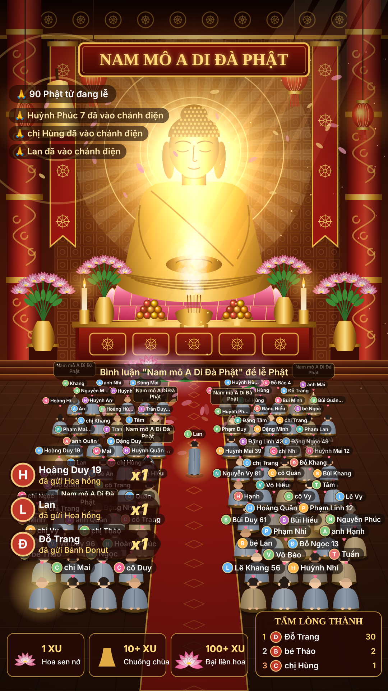

# 🙏 Chánh điện LIVE: game tương tác TikTok LIVE

Màn hình chánh điện có tượng Phật. Người xem vào phòng LIVE thì có một nhân vật mang **tên + ảnh đại diện** của họ, đi vào một chỗ trống và quỳ lễ. Bình luận, thả tim, theo dõi, tặng quà đều làm nhân vật phản ứng.

Nhân vật, hiệu ứng và âm thanh được vẽ/tổng hợp bằng code. Ảnh nền chánh điện là ảnh thiết kế do chủ kênh cung cấp.



## Luật tương tác

| Sự kiện TikTok | Hành động trong chùa |
|---|---|
| Người xem vào phòng | Tạo nhân vật có tên + avatar, đi theo thảm đỏ vào chỗ trống rồi quỳ và chắp tay. Giọng đọc: "A Di Đà Phật, chào mừng …" |
| Bình luận | Hiện bong bóng chữ trên đầu nhân vật |
| Bình luận "Nam mô A Di Đà Phật" (có dấu hay không dấu đều được, cả "nam mo") | Nhân vật lạy 3 lạy + tiếng mõ |
| Thả tim | Tim bay lên từ nhân vật, nhân vật vái/lạy + tiếng mõ |
| Theo dõi (follow) | Nhân vật được vầng hào quang vàng trên đầu (giữ suốt buổi) + giọng cảm ơn |
| Chia sẻ | Nhân vật chắp tay vái |
| Quà 1–9 xu (Hoa hồng…) | Hoa sen nở trước bàn thờ + tiếng khánh |
| Quà 10–99 xu | Chuông chùa đổ, ánh sáng vàng, mưa cánh hoa + giọng cảm ơn |
| Quà 100+ xu | Đại liên hoa, tia sáng toả, bảng tên người cúng dường + chuông lớn + giọng tri ân |

Người tặng quà còn được lên **bảng "Tấm lòng thành"** và có quầng sáng quanh nhân vật.

Chánh điện chứa tối đa 60 người với ảnh nền thiết kế (90 người với cảnh vẽ bằng code). Khi đầy, người im lặng lâu nhất sẽ nhường chỗ (người đã follow/tặng quà được ưu tiên giữ chỗ). Ai im lặng quá 20 phút sẽ tự rời đi.

## Cài đặt trên Windows

1. Cài **Node.js 20 trở lên** từ https://nodejs.org (chọn bản LTS).
2. Tải mã nguồn này về (nút **Code → Download ZIP** trên GitHub) và giải nén.
3. Bấm đúp **`run.bat`**. Lần đầu nó tự cài thư viện rồi mở trang điều khiển.
   - Hoặc mở Terminal trong thư mục và chạy `npm install` rồi `npm start`.

Hai trang quan trọng:

- **Trang điều khiển + giả lập:** http://127.0.0.1:3000/control.html
- **Màn hình game (đưa lên LIVE):** http://127.0.0.1:3000/game.html

## Chạy thử không cần LIVE (Test Lab)

Mở trang điều khiển, dùng các nút ở mục **2** và **3**: người vào, bình luận "Nam mô A Di Đà Phật", thả tim, theo dõi, ba mức quà, +50/+100 người, mưa quà, bão tim, tự chạy demo. Có ô nhập tên để thử với một người cụ thể.

Ngoài ra mở `http://127.0.0.1:3000/game.html?demo=1` để game tự sinh sự kiện liên tục.

## Đưa lên TikTok LIVE

Cách dễ nhất với TikTok LIVE Studio: chạy `run.bat`, rồi bấm đúp `mo-cua-so-game.bat` để mở game trong một cửa sổ Microsoft Edge riêng (khung dọc, không có thanh địa chỉ; Edge có sẵn giọng đọc AI tiếng Việt HoaiMy/NamMinh nên giọng hay nhất). Trong LIVE Studio thêm nguồn **Window capture** chọn cửa sổ đó.


1. Bắt đầu phát LIVE (TikTok LIVE Studio trên máy tính).
2. Trong LIVE Studio (hoặc OBS), thêm nguồn **Link / Browser source** với địa chỉ `http://127.0.0.1:3000/game.html`, kích thước **1080 × 1920**.
3. Vào trang điều khiển, nhập **username TikTok** của bạn (ví dụ `tranvankhai99`, không cần @) rồi bấm **Kết nối**. Dòng trạng thái chuyển xanh là đã nhận được sự kiện.
   - Có thể ghi sẵn username vào `config.json` (`"tiktokUsername"`) để tự kết nối khi chạy.
4. Âm thanh: trong OBS bật "Control audio via OBS" cho nguồn trình duyệt để tiếng chuông, mõ, giọng đọc lên sóng.

**Giọng đọc tiếng Việt**: mỗi lời chúc vừa được đọc thành tiếng vừa hiện chữ giữa màn hình. Từ bản 1.8 game dùng **giọng AI tự nhiên của Microsoft** (giọng nữ `vi-VN-HoaiMyNeural`, đổi sang giọng nam bằng `"ttsVoice": "vi-VN-NamMinhNeural"`; tốc độ `"ttsRate"`, ví dụ `"-10%"` chậm hơn). Cần có Internet. Nếu mạng lỗi thì tự chuyển sang giọng Google, rồi giọng có sẵn của Windows. Bấm nút **🔊 Thử giọng đọc** trên trang điều khiển để nghe thử. `"voiceEngine"`: `"auto"` (mặc định), `"online"` hoặc `"system"` (chỉ giọng của máy). Tắt giọng đọc: thêm `?voice=0` vào cuối địa chỉ game, hoặc đặt `"voice": false`. Tắt chữ lời chúc: `"captions": false`. Tắt hết âm thanh: `?sound=0`.

## Nhạc nền và lời chào

- **Nhạc thiền** phát liên tục: tiếng nền trầm, sáo ngũ cung chậm và tiếng khánh, tất cả tự tạo bằng code nên không lo bản quyền. Chỉnh âm lượng bằng `musicVolume` (0 đến 1), tắt bằng `"music": false` hoặc `?music=0`.
- Muốn dùng **bài nhạc Phật riêng**: chép file (ví dụ `nhac.mp3`) vào `public/assets/` rồi đặt `"musicFile": "assets/nhac.mp3"`. Chỉ dùng nhạc bạn có quyền phát trên LIVE, TikTok có thể tắt tiếng hoặc cảnh báo nếu nhạc vi phạm bản quyền.
- **Lời chào, cảm ơn** nằm trong mục `messages` của `config.json`, mỗi loại có nhiều câu và game chọn ngẫu nhiên, không lặp câu vừa đọc. `{name}` là tên người xem, `{gift}` là tên quà:
  - `join`: khi có người mới vào
  - `follow`, `share`: khi theo dõi, chia sẻ
  - `gift`, `bigGift`: khi tặng quà thường và quà từ 100 xu
  - `reminder`: lời mời thả tim, theo dõi, bình luận
  - `teaching`: lời nhắn tịnh tâm, lời chúc an lạc
  - `thanks`: cảm ơn những người mới vào (`{name}` là danh sách tên)
  - `chant`: câu niệm Phật, đọc kèm tiếng mõ và cả chánh điện cùng lạy
- **Lời dẫn tự động** (`narration`, mặc định bật): khi đã `narrationSeconds` giây (mặc định 30) không có câu nào được đọc, game tự đọc xen kẽ các loại câu trên để buổi LIVE không bị trầm. Đặt `"narration": false` để tắt, khi đó dùng nhắc nhở mỗi `reminderMinutes` phút như cũ.
- **Hào quang tượng Phật** (`buddhaLight`, mặc định bật): tia sáng xoay chậm, vầng sáng sau đầu, hạt vàng bay lên. Mỗi lần có người niệm Phật, theo dõi hay tặng quà, ánh sáng lan toả mạnh hơn.
- **Ảnh nền chánh điện**: mặc định dùng ảnh thiết kế `public/assets/chanh-dien.jpg` (khung 1080×1920), 60 chỗ quỳ được căn khớp với các bồ đoàn trong ảnh. Muốn quay về cảnh vẽ bằng code (90 chỗ) thì đặt `"backgroundImage": ""` và `"maxCharacters": 90`, hoặc thêm `?bg=0` vào địa chỉ. Nếu thay ảnh khác có bố cục bồ đoàn khác, cần sửa `DESIGN_ROWS` trong `public/js/scene.js`. Ảnh nền đã có sẵn chữ hoành phi, nên `title`/`subtitle` chỉ dùng cho cảnh vẽ bằng code.
- **Ảnh tượng Phật riêng** (chỉ cho cảnh vẽ bằng code): chép ảnh PNG nền trong suốt vào `public/assets/` và đặt `"buddhaImage": "assets/buddha.png"`. Để trống thì dùng tượng vẽ sẵn.

- **Nhân vật nền không tên**: `ambientMonks` (mặc định 6) sư thầy / chú tiểu và `ambientCrowd` (mặc định 30) Phật tử ngồi sẵn cho chánh điện đông vui. Không mang tên, không tính vào số người lễ. Người xem thật vào sẽ có tên và được nhường chỗ đẹp ở các hàng giữa; sau đó thỉnh thoảng có Phật tử không tên khác đi vào ngồi chỗ trống. Đặt 0 để tắt.
- **Không bật "Tự chạy demo" khi LIVE thật**: demo tạo người xem và quà giả, dễ đánh lừa người xem và vi phạm quy định của TikTok.

## Tuỳ chỉnh (`config.json`)

| Khoá | Ý nghĩa |
|---|---|
| `tiktokUsername` | Tự kết nối kênh này khi chạy |
| `title`, `subtitle` | Chữ trên hoành phi và dòng hướng dẫn |
| `maxCharacters` | Số chỗ quỳ tối đa (tối đa 90 theo bố cục hiện tại) |
| `idleMinutes` | Im lặng bao nhiêu phút thì nhân vật rời đi |
| `bowKeywords`, `bowCount` | Từ khoá làm nhân vật lạy và số lạy |
| `giftTiers` | Ngưỡng xu cho 3 mức hiệu ứng (`lotus`, `bell`, `grand`) |
| `sound`, `voice`, `voiceJoin` | Bật/tắt âm thanh, giọng đọc, giọng chào người mới vào |
| `music`, `musicFile`, `musicVolume` | Nhạc nền |
| `messages`, `reminderMinutes` | Các câu chào, cảm ơn, nhắc nhở |
| `buddhaImage` | Ảnh tượng Phật riêng (tuỳ chọn) |
| `backgroundImage` | Ảnh nền chánh điện (để trống = vẽ bằng code) |

Sửa xong chỉ cần tải lại trang game (F5), không cần khởi động lại.

## Lưu ý kỹ thuật

- Kết nối TikTok dùng thư viện không chính thức [`tiktok-live-connector`](https://github.com/zerodytrash/TikTok-Live-Connector). TikTok có thể đổi giao thức bất cứ lúc nào. Sự kiện "người vào phòng" đôi khi không đầy đủ, nên game cũng tạo nhân vật khi người xem bình luận, thả tim, follow hay tặng quà.
- Quà dạng chuỗi (combo) chỉ được tính một lần khi combo kết thúc, để không bị nhân đôi.
- Ảnh đại diện lấy trực tiếp từ TikTok. Nếu không tải được, nhân vật hiện chữ cái đầu của tên.

## Cấu trúc

```
server.js            Cầu nối TikTok LIVE -> WebSocket, phục vụ trang web
config.json          Cấu hình
public/game.html     Màn hình game (nguồn trình duyệt cho LIVE)
public/control.html  Bảng điều khiển + Test Lab
public/js/scene.js   Vẽ chánh điện, bàn thờ, chỗ quỳ
public/js/buddha.js  Vẽ tượng Phật A Di Đà trên đài sen
public/assets/       Ảnh tượng / nhạc riêng (tuỳ chọn)
public/js/game.js    Hiệu ứng, xử lý sự kiện, giao diện
public/js/characterArt.js  Vẽ nhân vật Phật tử mặc áo tràng
public/js/audio.js   Chuông, mõ, khánh, nhạc thiền (WebAudio) + giọng đọc
public/js/fake.js    Dữ liệu giả cho Test Lab
```

---

# 🪩 Quán bar LIVE (game thứ hai, dùng chung máy chủ)

Người xem vào LIVE sẽ được **thả từ trên trời xuống sàn nhảy** và tự nhảy theo nhạc.
Ai **thả tim nhiều** hoặc **tặng quà** sẽ được mời **lên sân khấu VIP** phía trên, camera zoom cận cảnh điệu nhảy vài giây.

| Hành động trên TikTok | Trong game |
|---|---|
| Vào phòng / bình luận lần đầu | Rơi từ trên trời xuống sàn, có cột sáng + tiếng "bịch" |
| Bình luận | Bong bóng chat; có chữ "quẩy", "nhảy", "🔥" thì nhảy tưng ngay |
| Thả tim | Nhảy sung + tim bay; mỗi tim = 1 điểm. Đủ 60 điểm → vào hàng chờ sân khấu |
| Quà nhỏ (dưới 10 xu) | Pháo sáng + tiền vàng; mỗi xu = 20 điểm |
| Quà từ 10 xu | Lên sân khấu ngay (được ưu tiên theo giá trị quà), pháo giấy, khói CO2 |
| Quà từ 100 xu | Pháo hoa toàn màn hình, còi hơi, lên sân khấu trước mọi người, 10 giây |
| Theo dõi | Đội vương miện 👑 |
| Chia sẻ | Pháo giấy |
| Cả phòng thả tim đầy thanh "ĐỘ QUẨY" | BÙNG NỔ: nhạc lên cao trào, laser, nháy đèn, mưa pháo giấy |

Sàn còn có vài bóng người nhảy **không tên** cho đỡ vắng; mỗi người xem thật vào sẽ thay chỗ một bóng.

### Chạy trên Windows
1. Giải nén, nhấp đúp **`run-bar.bat`** (lần đầu tự cài thư viện). Trình duyệt mở trang điều khiển `bar-control.html`.
2. Bấm các nút ở mục **Giả lập** để thử. Nút "❤️ x60" và "🎁 Quà 30 xu" sẽ đưa người lên sân khấu.
3. Khi đang LIVE: nhập username TikTok → **Kết nối**.
4. Nhấp đúp **`mo-cua-so-bar.bat`** để mở game trong cửa sổ Edge riêng, rồi trong TikTok LIVE Studio thêm nguồn **Chụp cửa sổ** chọn cửa sổ đó (hoặc nguồn Link/Browser: `http://127.0.0.1:3000/bar.html`, 1080×1920).
   Tắt ô "Bật nhạc" ở khung xem trước để không bị phát tiếng hai lần.

### Tuỳ chỉnh (`config-bar.json`)
- `clubName`, `subtitle`: tên quán, dòng giới thiệu.
- `stagePoints` (60): số điểm để lên sân khấu; `pointsPerCoin` (20); `stageGiftCoins` (10): quà từ mức này lên ngay.
- `stageSeconds` / `stageSecondsBig`: thời gian trên sân khấu; `cameraZoom`: độ zoom camera.
- `hypeMax`: lượng tim cần để "BÙNG NỔ"; `ambientCrowd`: số bóng người không tên.
- **Nhạc riêng**: chép file `.mp3`/`.m4a` vào thư mục `public/assets/nhac-bar/`. Game phát lần lượt theo tên file (đặt `01 ...`, `02 ...` để chọn thứ tự), hết bài cuối quay lại bài đầu. Thư mục trống thì dùng nhạc sàn tự tạo (không bản quyền). Lưu ý: nhạc có bản quyền có thể bị TikTok tắt tiếng hoặc cảnh cáo LIVE.
- **DJ**: có sẵn nhân vật DJ vẽ bằng code (tóc vàng, yếm ánh kim) ở màn LED sau sân khấu và đứng sau bàn DJ trên bục. Muốn dùng ảnh DJ riêng trên màn LED: chép ảnh vào `public/assets` rồi ghi `"djImage": "assets/ten-anh.jpg"` (chỉ dùng ảnh bạn có quyền sử dụng). `musicLabel`: chữ hiện dưới màn LED khi không có tên bài.
- `ttsVoice`: giọng MC, mặc định giọng nam `vi-VN-NamMinhNeural` (đổi `vi-VN-HoaiMyNeural` nếu muốn giọng nữ).
- `messages`: các câu MC đọc.

Mã nguồn game quán bar: `public/bar.html`, `public/bar-control.html`, `public/js/bar/`.
